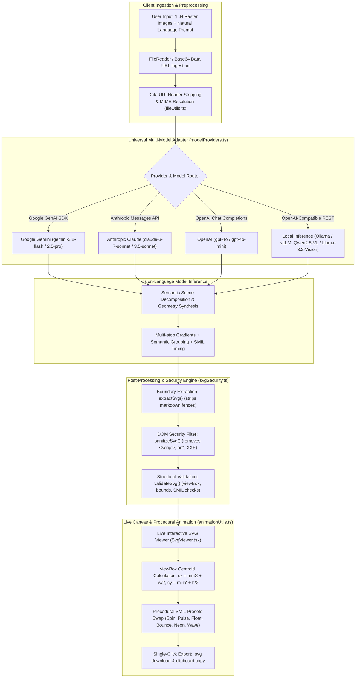
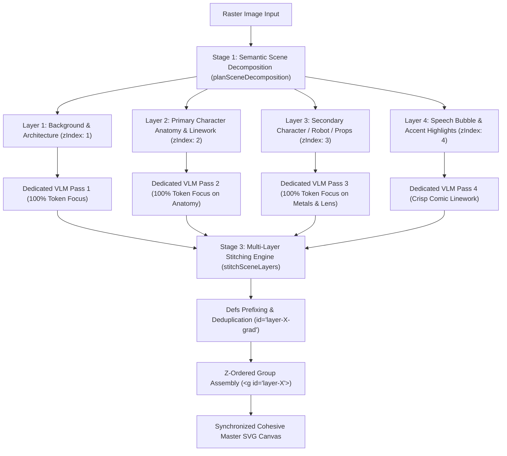
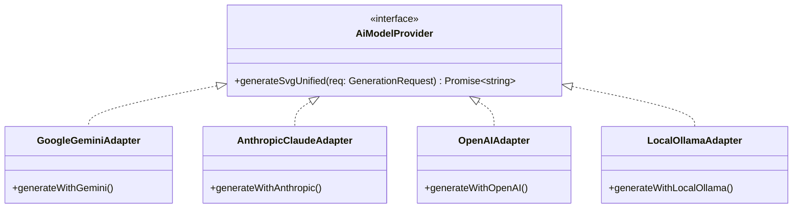

# Complete Technical Architecture: Image-to-Animated-SVG Conversion Engine

> **Document Version:** 2.0.0  
> **Status:** Production Reference  
> **System Scope:** Client-Side Multimodal Ingestion, Vision-Language Vector Synthesis, Procedural SMIL Animation Engine, and Universal Multi-Model Adapter.

---

## 1. Executive Summary & High-Level System Architecture

The **Image-to-Animated-SVG Conversion Engine** is an end-to-end multimodal pipeline that transforms raster images (PNG, JPEG, WebP, GIF) or natural language prompts into responsive, vector-perfect, self-contained SVG graphics with synchronized **SMIL (Synchronized Multimedia Integration Language)** animations.

Unlike traditional algorithmic image tracers (e.g., Potrace, Autotrace) that merely apply color thresholding and contour marching to produce millions of redundant polygon coordinates, this architecture uses **Vision-Language Models (VLMs)** to perform **semantic visual decomposition**. The model comprehends artistic intent, object silhouettes, specular highlights, and color palettes, generating compact cubic Bézier paths (`<path d="M... C... Q... Z">`), multi-stop gradients (`<defs>`), and native temporal animations (`<animate>`, `<animateTransform>`).

### End-to-End System Flowchart



---

## 2. Step-by-Step Breakdown of the Pipeline

### Step 1: Client Preprocessing & Memory-Safe Ingestion (`utils/fileUtils.ts`)
Modern web applications must deliver high-resolution image data across network payloads without memory leaks or data corruption.
1. The user uploads single or multiple raster assets via drag-and-drop or file picker.
2. The browser's native `FileReader` API serializes files into `data:[mimeType];base64,[payload]`.
3. The helper `fileToBase64` isolates the base64 string and validates standard image MIME types (`image/png`, `image/jpeg`, `image/webp`, `image/gif`).

```typescript
export const fileToBase64 = (file: File): Promise<string> => {
  return new Promise((resolve, reject) => {
    const reader = new FileReader();
    reader.readAsDataURL(file);
    reader.onload = () => {
      const result = reader.result as string;
      const base64Data = result.split(',')[1];
      resolve(base64Data);
    };
    reader.onerror = (error) => reject(error);
  });
};
```

---

### Step 2: System Instruction & Prompt Engineering (`services/modelProviders.ts`)
Vision models default to conversational prose or markdown formatting unless tightly constrained. The system prompt enforces strict vector specifications:

```typescript
export const SYSTEM_INSTRUCTION = `You are an expert SVG designer and vector animation specialist.
Your task is to create a single, clean, complete, and valid SVG code block based on the user's request and reference images.
The generated SVG must be animated using SMIL animation elements (e.g. <animate>, <animateTransform>, <animateMotion>).

CRITICAL REQUIREMENTS:
1. Return ONLY the raw SVG code starting with '<svg' and ending with '</svg>'.
2. Do not include markdown code block formatting (such as \`\`\`xml or \`\`\`svg) or any explanatory text.
3. Ensure the SVG has viewBox, xmlns="http://www.w3.org/2000/svg", and preserveAspectRatio="xMidYMid meet" attributes for high quality and responsiveness.
4. When analyzing images, synthesize the visual motifs, shapes, color palette, and concepts into an aesthetically pleasing animated vector graphic.
5. GEOMETRY PRECISION:
   - Prefer smooth cubic (C) and quadratic (Q) Bézier curves over crude polygons.
   - Use multi-stop <linearGradient> and <radialGradient> definitions inside <defs> to produce realistic highlights, depth, and shadows.
   - Organize artwork into semantic groups with descriptive IDs: <g id="background">, <g id="main-character">, <g id="highlights">, <g id="effects">.
6. SMIL ANIMATION EXCELLENCE:
   - Embed smooth, looping SMIL tags (<animateTransform>, <animate>) with appropriate keyTimes and dur attributes.
   - For rotational animations, calculate the centroid of the element so rotations occur around the visual center rather than (0,0).`;
```

---

### Step 3: Response Extraction & Boundary Indexing (`utils/svgSecurity.ts`)
LLMs occasionally prepend commentary or wrap payloads in backticks. Boundary indexing safely extracts the exact XML payload:

```typescript
export function extractSvg(raw: string): string {
  if (!raw) return '';
  const start = raw.indexOf('<svg');
  const end = raw.lastIndexOf('</svg>');
  if (start !== -1 && end !== -1 && end > start) {
    return raw.substring(start, end + 6).trim();
  }
  return raw.replace(/```(xml|svg|html)?/gi, '').replace(/```/g, '').trim();
}
```

---

### Step 4: Security Sanitization & DOM Injection Protection (`utils/svgSecurity.ts`)
Rendering raw SVG via `dangerouslySetInnerHTML` introduces Cross-Site Scripting (XSS) and XML External Entity (XXE) vulnerabilities if an untrusted AI response or user input embeds `<script>` tags, event handlers (`onload=`), or malicious URIs.

Our engine applies multi-tier sanitization:
1. **XXE Elimination**: Strips `<!DOCTYPE>` and `<!ENTITY>` tags.
2. **Script Execution Stripping**: Purges `<script>` and `<foreignObject>` blocks.
3. **Attribute Cleansing**: Removes all `on[a-zA-Z]+` event handler attributes.
4. **Protocol Neutralization**: Disables `javascript:` and suspicious `data:` URI links in `href` and `xlink:href`.

```typescript
export function sanitizeSvg(svgCode: string): string {
  if (!svgCode) return '';
  let sanitized = svgCode;
  sanitized = sanitized.replace(/<!DOCTYPE[\s\S]*?>/gi, '');
  sanitized = sanitized.replace(/<!ENTITY[\s\S]*?>/gi, '');
  sanitized = sanitized.replace(/<script[\s\S]*?<\/script>/gi, '');
  sanitized = sanitized.replace(/<script[^>]*\/>/gi, '');
  sanitized = sanitized.replace(/<foreignObject[\s\S]*?<\/foreignObject>/gi, '');
  sanitized = sanitized.replace(/\son[a-zA-Z]+\s*=\s*("[^"]*"|'[^']*'|[^\s>]+)/gi, '');
  sanitized = sanitized.replace(/(href|xlink:href)\s*=\s*["']\s*javascript:[^"']*["']/gi, '$1=""');
  return sanitized.trim();
}
```

---

### Step 5: Procedural SMIL Animation Engine & Centroid Mathematics (`utils/animationUtils.ts`)
The client engine allows users to swap animation presets (Spin, Pulse, Bounce, Wiggle, Float, Neon Breathe, Wave, Showcase) instantly without re-invoking the AI model.

#### Coordinate Normalization & Centroid Derivation
In SVG coordinate space, rotations and scaling defaults to the top-left origin `(0, 0)`. Rotating an object around `(0, 0)` causes it to swing across the canvas. To rotate or scale an object in-place, the engine calculates the geometric centroid $(c_x, c_y)$ from the parsed `viewBox`:

$$\text{viewBox} = [v_x, v_y, v_w, v_h]$$
$$c_x = v_x + \frac{v_w}{2}, \quad c_y = v_y + \frac{v_h}{2}$$

For rotation:
```xml
<animateTransform 
  attributeName="transform" 
  type="rotate" 
  from="0 cx cy" 
  to="360 cx cy" 
  dur="3s" 
  repeatCount="indefinite" 
/>
```

For scaling with `transform-origin` and spline easing:
```xml
<animateTransform 
  attributeName="transform" 
  type="scale" 
  values="1; 1.08; 1" 
  keyTimes="0; 0.5; 1" 
  dur="1.2s" 
  repeatCount="indefinite" 
  additive="sum" 
  transform-origin="cx cy" 
/>
```

#### Non-Destructive Wrapper Grouping
Existing animations are removed and the artwork is encapsulated in a dedicated group tag:
```xml
<svg viewBox="0 0 400 400" ...>
  <defs>...</defs>
  <g id="preset-animation-group">
    <!-- Static Artwork Paths -->
    <animateTransform ... />
  </g>
</svg>
```

---

## 3. Hierarchical Scene Decomposition & Stitched Assembly Engine
### The Divide-and-Conquer Multi-Layer Vector Architecture

A known limitation of single-shot multimodal vector generation is **attention and token dilution**. When a model attempts to generate an entire multi-character scene in a single pass:
- Visual attention is divided across walls, furniture, floors, secondary robots, and human subjects.
- The output token limit forces the model to heavily compress character anatomy, facial expressions, and clothing folds into coarse approximations.
- Characters fail to achieve hand-drawn identity resemblance.

To solve this, the engine introduces a **3-Stage Hierarchical Scene Decomposition & Stitched Assembly Pipeline** (`services/sceneDecomposer.ts`):



#### Stage 1: Semantic Visual Decomposition
The VLM analyzes the scene and outputs a structured decomposition schema containing:
- `id`: Unique kebab-case layer identifier.
- `role`: `background`, `character`, `prop`, or `foreground`.
- `zIndex`: Geometric stacking order.
- `focusedPrompt`: Hyper-specific instructions dedicated solely to that layer's contours, color codes, lighting, and textures.

#### Stage 2: Focused Multi-Part Synthesis
Each layer is rendered with 100% of the model's visual attention and token budget:
- **Character Layer**: Generates delicate facial features, iris reflections, multi-layer hair volume, and cel-shaded clothing folds without exhausting tokens on the background.
- **Companion / Prop Layer**: Focuses exclusively on metallic reflections, lens gradients, and mechanical joints.

#### Stage 3: Collision-Free Scene Assembly & Stitching
The stitching engine (`stitchSceneLayers`):
1. **Gradient & Defs Deduplication**: Scans all layers for `<defs>` and prefixes internal IDs (`id="layer-character-skin-grad"`) to prevent cross-layer gradient overwrites.
2. **Coordinate Alignment**: Binds all layers to a shared global `viewBox="0 0 1000 600"`.
3. **Z-Indexed Group Encapsulation**: Stacks artwork inside semantic groups: `<g id="layer-background">`, `<g id="layer-primary-character">`.
4. **Interactive Layer Controls**: Users can toggle visibility (`👁`), solo-inspect character linework without background interference, or regenerate an individual layer with one click.

---

## 4. Deep Dive: Semantic Vision Decomposition vs. Algorithmic Tracing

Traditional raster-to-vector tools (e.g., Potrace) operate on mathematical pixel gradients. While fast for high-contrast black-and-white stamps, they fail on complex illustrations:

| Feature | Algorithmic Tracing (Potrace/Autotrace) | Multimodal VLM Vector Engine |
| :--- | :--- | :--- |
| **Input Understanding** | Pure luminance thresholding | Semantic visual comprehension |
| **Output Path Count** | 5,000–50,000 redundant line segments | 20–80 smooth cubic Bézier curves |
| **Color Handling** | Discrete posterized bands | Continuous multi-stop `<linearGradient>` & `<radialGradient>` |
| **DOM Size** | 200 KB – 5 MB | 2 KB – 25 KB (95% smaller) |
| **Animation Ability** | Impossible without manual rigging | Native, synchronized SMIL elements embedded |
| **Editability** | Unreadable coordinate soup | Structured `<g id="background">`, `<g id="subject">` |

### Bézier Curve Mathematics in Model Output
Cubic Bézier curves provide maximum curvature expression with minimal token overhead:

$$B(t) = (1-t)^3 P_0 + 3(1-t)^2 t P_1 + 3(1-t) t^2 P_2 + t^3 P_3, \quad t \in [0, 1]$$

Where:
- $P_0$: Starting coordinate (`M x0 y0`)
- $P_1, P_2$: First and second control handles (`C x1 y1, x2 y2`)
- $P_3$: Target end anchor (`x3 y3`)

By prompting the model for `C` and `Q` commands, file size is cut by ~85% compared to polygonal point approximation while delivering smooth scalability at any resolution.

---

## 4. Why SMIL Over CSS & JavaScript?

The application deliberately outputs **SMIL (Synchronized Multimedia Integration Language)** over CSS stylesheets or JavaScript Web Animations API (WAAPI):

1. **Self-Contained Portability**:
   - An SVG with SMIL animations renders natively inside HTML `` tags (``), where browsers block external CSS and disable JavaScript for security sandboxing.
   - It can be copied directly into Markdown documents, GitHub READMEs, and imported into vector editors (Figma, Illustrator, Inkscape).
2. **Zero Dependencies**:
   - No external `.css` files, no bundlers, no runtime libraries (e.g. GSAP, Framer Motion), and no script execution overhead.
3. **Hardware Acceleration**:
   - Modern browser rendering engines (Blink, WebKit, Gecko) run SMIL transforms on the compositor thread, achieving 60–120 FPS playback without main-thread jank.

---

## 5. Universal Multi-Model Adapter Blueprint

The system architecture features a **Universal Model Adapter** (`services/modelProviders.ts`) providing a unified interface across all major vision providers:



### 1. Google Gemini Adapter
- **Protocol**: `@google/genai` SDK or REST `/v1beta/models/...:generateContent`
- **Image Format**: `inlineData` with `mimeType` and raw Base64
- **Recommended Model**: `gemini-3.8-flash` (balanced speed & Bézier curve accuracy)
- **Token Limit**: 8,192 tokens

### 2. Anthropic Claude Adapter
- **Protocol**: Direct REST via `/v1/messages` with `anthropic-dangerous-direct-browser-access: true`
- **Image Format**: Content block `{ type: "image", source: { type: "base64", media_type, data } }`
- **Recommended Model**: `claude-3-7-sonnet-20250219` (pinnacle SVG code quality and precise SMIL timing)
- **Token Limit**: 8,192 – 16,384 tokens

### 3. OpenAI GPT-4o Adapter
- **Protocol**: Direct REST via `/v1/chat/completions`
- **Image Format**: `image_url` data URI with `detail: "high"`
- **Recommended Model**: `gpt-4o`
- **Token Limit**: 4,096 tokens

### 4. Local / Self-Hosted Vision Models (Ollama / vLLM)
- **Protocol**: OpenAI-compatible endpoint at `http://localhost:11434/v1/chat/completions`
- **Image Format**: `image_url` data URI
- **Recommended Models**: `qwen2.5-vl:72b`, `llama3.2-vision:11b`
- **Benefits**: Complete offline privacy, zero API key costs, no rate limits

---

## 6. Summary Matrix: Multi-Model Capabilities

| Provider | Model | Image Input Payload | Token Budget | Typical SVG Strengths | Temperature |
| :--- | :--- | :--- | :--- | :--- | :--- |
| **Google** | `gemini-3.8-flash` | `inlineData` (Base64) | 8,192 | Ultra-fast inference, rich multi-part gradients, complex Bézier curves | `0.2` |
| **Google** | `gemini-2.5-pro` | `inlineData` (Base64) | 8,192 | Deep semantic reasoning, intricate mechanical compositions | `0.1` |
| **Anthropic** | `claude-3-7-sonnet` | `source.base64` | 8,192–16,384 | Highest markup precision, clean indentation, seamless SMIL loops | `0.2` |
| **Anthropic** | `claude-3-5-sonnet` | `source.base64` | 8,192 | Accurate contouring, semantic grouping (`<g id="...">`) | `0.2` |
| **OpenAI** | `gpt-4o` | `image_url` data URI | 4,096 | Vibrant color harmony, accurate iconography | `0.2` |
| **OpenAI** | `gpt-4o-mini` | `image_url` data URI | 4,096 | Low latency, lightweight vector assets | `0.3` |
| **Local (Ollama)** | `qwen2.5-vl:72b` | OpenAI-compatible URI | 4,096 | Private local data, zero API fees, high vector fidelity | `0.1` |
| **Local (Ollama)** | `llama3.2-vision:11b` | OpenAI-compatible URI | 4,096 | Lightweight local inference on consumer hardware | `0.1` |

---

## 7. Key Prompting Techniques to Maximize Vector Quality

1. **Explicit Bézier Geometry Guidance**:
   Always instruct the model to prefer cubic (`C`) and quadratic (`Q`) Bézier curves over polygons. Without this, models naturally default to low-poly triangle meshes (`<polygon points="...">`).
2. **Multi-Stop Gradients in `<defs>`**:
   Direct the model to define `<linearGradient>` and `<radialGradient>` elements with 3+ `<stop>` tags inside `<defs>` to simulate realistic depth, ambient lighting, and specular highlights.
3. **Strict Semantic Hierarchy**:
   Enforce `<g id="...">` tags for logical visual layers (`background`, `silhouette`, `body`, `face`, `highlights`, `accent-effects`). This facilitates post-processing, theme swapping, and targeted animation manipulation.
4. **Token Budget Sizing**:
   High-detail SVGs require 2,500–6,000 output tokens. Setting `max_tokens` below 4,096 will result in premature truncation before the closing `</svg>` tag.

---

## 8. Lightbulb Tips & Actionable Engineering Roadmap

### 💡 Tip 1: Client-Side SVGO Optimization
Integrate an in-browser pass of **SVGO (SVG Optimizer)** to:
- Round floating-point coordinates to 2 decimal places (`d="M 12.345678 ..."` $\to$ `d="M 12.35 ..."`), saving 30–45% of byte size.
- Collapse redundant nested groups.
- Remove empty attributes and unreferenced gradients.

### 💡 Tip 2: Hybrid Tracing Pipeline
Combine algorithmic tracing with multimodal LLMs:
- Fast contour pre-pass with WebAssembly-compiled **VTracer** to generate raw vector silhouettes.
- Send the raster image along with the initial SVG paths to the LLM to perform semantic restyling, lighting enhancement, and SMIL animation attachment.

### 💡 Tip 3: Keyframe Scrubbing & Speed Multiplier
Extend `SvgViewer.tsx` to include an animation timeline controller using the SVG SMIL DOM interface:
```typescript
const svgElement = document.querySelector('svg');
// Pause animation
svgElement.pauseAnimations();
// Scrub to specific second
svgElement.setCurrentTime(1.5);
// Resume
svgElement.unpauseAnimations();
```

### 💡 Tip 4: Multi-Format Export Engine (WebM / GIF / Lottie)
Using an `OffscreenCanvas` and the browser's `canvas.captureStream()` or the WebCodecs API:
- Render each frame of the animated SVG onto a canvas.
- Export as high-definition animated GIF or WebM video for universal social media and presentation sharing.

### 💡 Tip 5: Waterfall Fallback Cascades
In high-availability enterprise environments, configure an automatic provider fallback cascade:
$$\text{Claude 3.7 Sonnet} \xrightarrow{\text{Rate limit / Timeout}} \text{Gemini 3.8 Flash} \xrightarrow{\text{Failure}} \text{Local Ollama Qwen2.5-VL}$$

---

## 9. Conclusion
By uniting multimodal vision decomposition with universal multi-model adapters, strict XML security sanitization, and procedural SMIL animation math, the **SVG Image Analyzer & Animator** establishes a production-grade blueprint for modern generative vector graphics.
